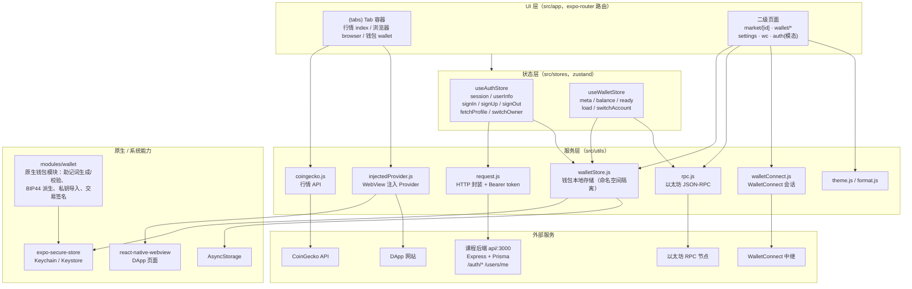
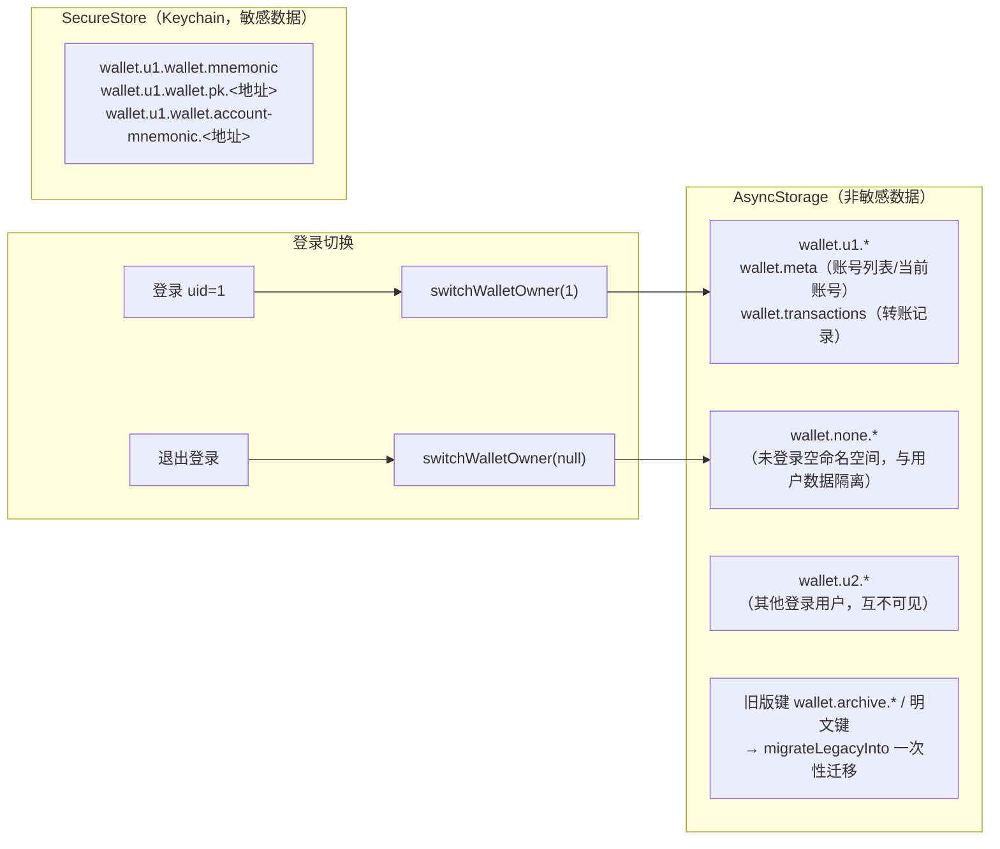
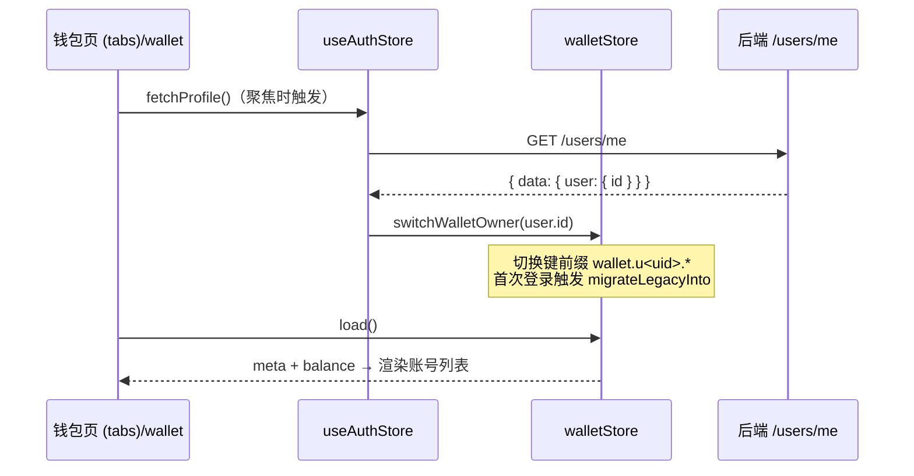

                                                                        # RN DeFi Wallet

基于 React Native + Expo 的 DeFi 移动钱包，
//配套 [React Native 实战课程](https://clwy.cn/courses/react-native)后端接口。


## 功能

- **行情**：CoinGecko 加密货币行情列表、币种详情
- **浏览器**：内置 DApp 浏览器（WebView + 注入 Provider），可连接 DApp
- **钱包**：
  - 创建 / 导入助记词钱包，BIP44 派生账号
  - 新增账号三种方式：助记词派生 / 导入私钥 / 独立新助记词
  - 收发转账（转账记录本地保存）、信息签名、导出助记词
  - WalletConnect 连接外部 DApp（连接钱包）
- **设置**：主题切换、退出登录、注销账号

## 技术栈

| 模块        | 选型                                                 |
| ----------- | ---------------------------------------------------- |
| 框架        | Expo SDK 57 / React Native 0.86 / React 19           |
| 路由        | expo-router（文件系统路由）                          |
| 状态管理    | zustand                                              |
| 钱包核心    | `modules/wallet`（原生模块，助记词/私钥/签名）       |
| 敏感数据    | expo-secure-store（iOS Keychain / Android Keystore） |
| 本地存储    | @react-native-async-storage/async-storage            |
| DApp 连接   | WalletConnect Sign Client v2                         |
| 图表/二维码 | react-native-svg + react-native-qrcode-svg           |

## 目录结构

```
RNDefiWallet/
├── api/        # 课程后端（Express + Prisma，端口 3000）
└── fronted/    # 本前端项目
    ├── modules/wallet/        # 钱包原生模块（助记词、私钥、派生、签名）
    ├── plugins/               # Expo config plugins
    └── src/
        ├── app/               # expo-router 路由
        │   ├── (tabs)/        # 行情 / 浏览器 / 钱包 三个 Tab
        │   ├── auth/          # 登录 & 注册（模态）
        │   ├── browser/       # DApp 浏览器
        │   ├── market/        # 币种详情
        │   ├── settings/      # 设置
        │   ├── wallet/        # 创建/导入/新增账号/转账记录/签名/导出
        │   └── wc/            # WalletConnect 连接
        ├── stores/            # zustand：auth.js / wallet.js
        ├── utils/             # walletStore.js / request.js / rpc.js / coingecko.js 等
        └── components/
```

## 快速开始

### 1. 启动后端

```bash
cd api
npm install
npx prisma generate
npm start        # http://localhost:3000，接口文档见 api/README.md
```

### 2. 配置前端

```bash
cd fronted
npm install
```

创建 `.env`（API 地址建议直接用局域网 IP，不要用 localhost）：

```bash
EXPO_PUBLIC_API_URL=http://<你的局域网IP>:3000
EXPO_PUBLIC_WC_PROJECT_ID=<WalletConnect Project ID>
```

> .env 是打包时注入的，改完需要重启 metro。

### 3. 启动

```bash
npm run ios      # 需要 ios/ 目录已存在（开发客户端模式）
```

或经开发客户端加载：

```bash
npx expo start
```

模拟器内打开 `clwy://` 深链可直达指定路由；开发客户端冷启动：

```bash
xcrun simctl terminate booted com.hrbbcfc.client
xcrun simctl openurl booted "com.hrbbcfc.client://expo-development-client/?url=<metro 地址>"
```

## 架构图

### 整体架构



### 钱包存储分层（按登录账号隔离）



### 登录 / 钱包数据流转



### 架构要点

- **状态管理（zustand）**：[src/stores/auth.js](src/stores/auth.js) 管登录态与用户信息；[src/stores/wallet.js](src/stores/wallet.js) 管钱包元数据与余额。
- **钱包存储（按登录账号隔离）**：[src/utils/walletStore.js](src/utils/walletStore.js)
  - 助记词、私钥存 SecureStore（Keychain/Keystore）；账号列表、交易记录等非敏感数据存 AsyncStorage
  - 所有键按登录用户加命名空间前缀 `wallet.u<uid>.`，未登录落在隔离的 `wallet.none.` 空命名空间
  - 退出登录只是切换前缀，数据不搬家；重新登录原样恢复；旧版数据由 `migrateLegacyInto` 一次性迁移
- **HTTP 封装**：[src/utils/request.js](src/utils/request.js)，接口统一返回 `{status, message, data}`；401 自动跳登录

## 测试账号

`admin / 123123`（本地后端）

## License

见 [LICENSE](LICENSE)。
