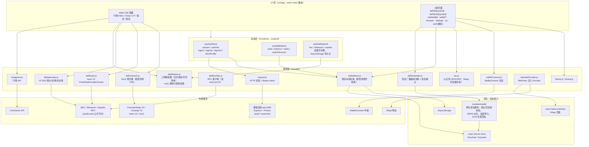
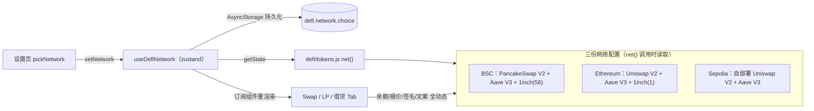
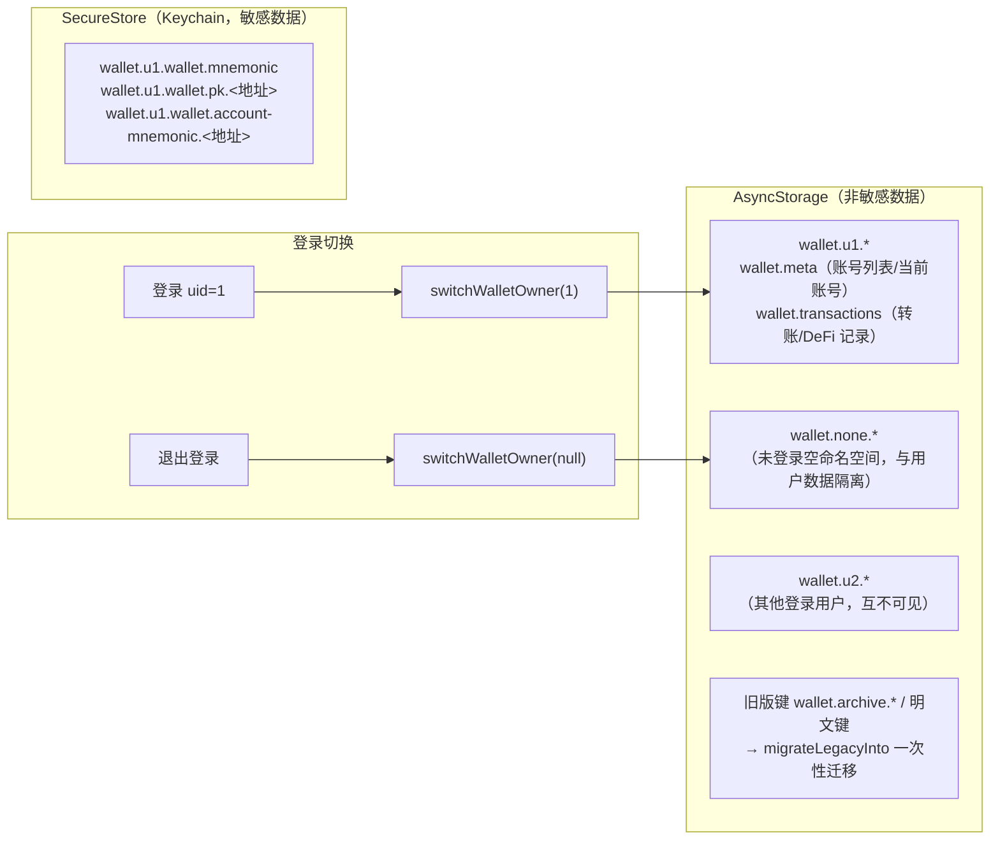
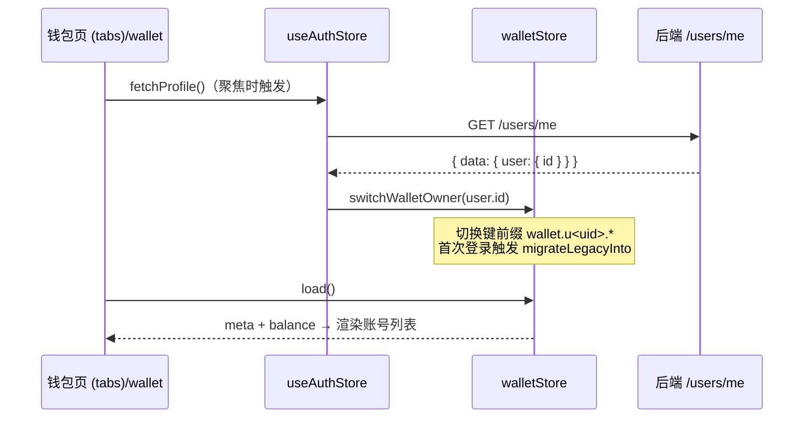

# RN DeFi Wallet

基于 React Native + Expo 的 DeFi 移动钱包，
配套 [React Native 实战课程](https://clwy.cn/courses/react-native)后端接口。


## 功能

- **行情**：CoinGecko 加密货币行情列表、币种详情
- **Swap**：V2 DEX 链上报价兑换（BSC: PancakeSwap V2 / Ethereum: Uniswap V2），
  1inch 聚合器实验选项（BSC / Ethereum），滑点设置、原生币自动走 wrapped 路径
- **LP**：V2 交易对的流动性池子列表、添加 / 移除流动性（按储备比例自动搭配原生币，
  按份额取回两种代币）
- **借贷**：Aave V3 存币生息——账户总览（总抵押 / 总负债 / 健康因子）、资产存入 / 取回
  （原生币自动 wrap / unwrap）
- **钱包**：
  - 创建 / 导入助记词钱包，BIP44 派生账号
  - 新增账号三种方式：助记词派生 / 导入私钥 / 独立新助记词
  - 收发转账（转账记录本地保存，含 DeFi 交易记录）、信息签名、导出助记词
  - WalletConnect 连接外部 DApp（连接钱包）
- **浏览器**：内置 DApp 浏览器（WebView + 注入 Provider），可连接 DApp
- **设置**：语言切换（跟随系统 / 简体中文 / English）、DeFi 网络切换、主题、退出登录

### DeFi 多网络

三套网络配置集中在 [src/utils/defi/tokens.js](src/utils/defi/tokens.js)，设置页一键切换、即时生效（无需重启）：

| 网络 | DEX | 借贷 | 1inch | 说明 |
| ---- | --- | ---- | ----- | ---- |
| BSC 主网（默认） | PancakeSwap V2 | Aave V3 | ✅ | |
| Ethereum 主网 | Uniswap V2 | Aave V3 | ✅ | 真实资产，WETH/USDT 等池子流动性充足 |
| Sepolia 测试网 | Uniswap V2（项目自部署） | Aave V3（官方测试部署，WETH deposit 受限） | ❌ | Swap/LP 用项目自部署合约 + Mock 代币，方便无门槛测试 |

所有链上常量（RPC / Router / Factory / Aave / 代币清单）都通过 `net()` 在调用时现场读取，
Swap / LP / 借贷页面与签名广播（chainId、原生币符号、手续费文案）全动态跟随网络。
合约地址均经 `eth_call` 逐一链上核验（Aave 地址来自 @bgd-labs/aave-address-book）。

## 技术栈

| 模块        | 选型                                                 |
| ----------- | ---------------------------------------------------- |
| 框架        | Expo SDK 57 / React Native 0.86 / React 19           |
| 路由        | expo-router（文件系统路由）                          |
| 状态管理    | zustand                                              |
| 钱包核心    | `modules/wallet`（原生模块，Trust Wallet Core：助记词/私钥/EVM 签名） |
| 敏感数据    | expo-secure-store（iOS Keychain / Android Keystore） |
| 本地存储    | @react-native-async-storage/async-storage            |
| DeFi        | PancakeSwap V2 / Uniswap V2 / Aave V3 / 1inch（eth_call 直连，无 SDK） |
| DApp 连接   | WalletConnect Sign Client v2                         |
| 国际化      | i18n-js（zh / en，跟随系统）                         |
| 图表/二维码 | react-native-svg + react-native-qrcode-svg           |

## 目录结构

```
RNDefiWallet/
├── api/        # 课程后端（Express + Prisma，端口 3000）
└── fronted/    # 本前端项目
    ├── modules/wallet/        # 钱包原生模块（助记词、私钥、派生、EVM 交易签名）
    ├── plugins/               # Expo config plugins
    └── src/
        ├── app/               # expo-router 路由
        │   ├── (tabs)/        # 行情 / Swap / LP / 借贷 / 钱包 五个 Tab
        │   ├── auth/          # 登录 & 注册（模态）
        │   ├── browser/       # DApp 浏览器
        │   ├── defi/          # DeFi 二级页：lp/[symbol]、lend/[symbol]
        │   ├── market/        # 币种详情
        │   ├── settings/      # 设置（语言 / DeFi 网络）
        │   ├── wallet/        # 创建/导入/新增账号/转账记录/签名/导出
        │   └── wc/            # WalletConnect 连接
        ├── stores/            # zustand：auth.js / wallet.js / defiNetwork.js
        ├── utils/
        │   ├── defi/          # DeFi 服务层：tokens.js（网络配置）/ pancake.js /
        │   │                  #   aave.js / oneInch.js / bscRpc.js / txSender.js /
        │   │                  #   erc20.js / useBscWallet.js
        │   ├── walletStore.js / request.js / rpc.js / coingecko.js
        │   └── injectedProvider.js / walletConnect.js / theme.js / format.js
        ├── i18n/              # locales/{zh,en}/ 多语言文案
        └── components/
            └── defi/          # DeFi 三 tab 共用组件（引导页 / 代币 sheet / 记录写入）
```

## 快速开始

### 1. 启动后端

```bash
cd api
npm install
npx prisma generate
npm start        # http://localhost:3000，接口文档见 api/README.md
```

### 2. 配置前端

```bash
cd fronted
npm install
```

创建 `.env`（API 地址建议直接用局域网 IP，不要用 localhost）：

```bash
EXPO_PUBLIC_API_URL=http://<你的局域网IP>:3000
EXPO_PUBLIC_WC_PROJECT_ID=<WalletConnect Project ID>
```

> .env 是打包时注入的，改完需要重启 metro。

### 3. 启动

```bash
npm run ios      # 需要 ios/ 目录已存在（开发客户端模式）
```

或经开发客户端加载：

```bash
npx expo start
```

模拟器内打开 `clwy://` 深链可直达指定路由（如 `clwy://swap`）；开发客户端冷启动：

```bash
xcrun simctl terminate booted com.hrbbcfc.client
xcrun simctl openurl booted "com.hrbbcfc.client://expo-development-client/?url=<metro 地址>"
```

## 架构图

### 整体架构



### DeFi 网络切换



> 切换无需重启：所有合约地址、RPC URL、chainId、代币清单、原生币符号、手续费
> 都通过 `net()` 在调用时现场读取；余额按 `[address, network]` 自动重新拉取。

### 钱包存储分层（按登录账号隔离）



### 登录 / 钱包数据流转



### 架构要点

- **状态管理（zustand）**：[src/stores/auth.js](src/stores/auth.js) 管登录态与用户信息；[src/stores/wallet.js](src/stores/wallet.js) 管钱包元数据与余额；[src/stores/defiNetwork.js](src/stores/defiNetwork.js) 管 DeFi 网络（三网络持久化）。
- **钱包存储（按登录账号隔离）**：[src/utils/walletStore.js](src/utils/walletStore.js)
  - 助记词、私钥存 SecureStore（Keychain/Keystore）；账号列表、交易记录等非敏感数据存 AsyncStorage
  - 所有键按登录用户加命名空间前缀 `wallet.u<uid>.`，未登录落在隔离的 `wallet.none.` 空命名空间
  - 退出登录只是切换前缀，数据不搬家；重新登录原样恢复；旧版数据由 `migrateLegacyInto` 一次性迁移
- **DeFi 网络抽象**：[src/utils/defi/tokens.js](src/utils/defi/tokens.js) 集中三份网络配置（合约地址 / 代币清单 / RPC），其余代码全部通过 `net()` 调用时读取——切换网络不散落任何 if/else
- **签名通道**：[src/utils/defi/txSender.js](src/utils/defi/txSender.js) 复用 `modules/wallet` 原生签名（Trust Wallet Core），签名前弹确认（方法 / 金额 / gas），带固有 gas 下限与回执等待
- **HTTP 封装**：[src/utils/request.js](src/utils/request.js)，接口统一返回 `{status, message, data}`；401 自动跳登录
- **国际化**：[src/i18n/](src/i18n/index.js)，i18n-js，zh / en 两种语言（跟随系统可切换），链名 / 原生币符号等动态参数经插值传入

## 测试账号

`admin / 123123`（本地后端）

## License

见 [LICENSE](LICENSE)。
